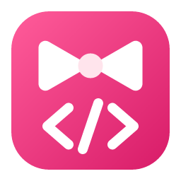

<p align="center">
   em fundo rosa" />
</p>

<h1 align="center">Duo Code</h1>

<p align="center">
  Questões de código no estilo LeetCode com a motivação diária do Duolingo:<br />
  resolva pelo menos uma por dia, mantenha o streak, ganhe XP e destrave conquistas.
</p>

---

## Sobre o projeto

O Duo Code é um **projeto pessoal de estudo**. Eu o criei para treinar para entrevistas técnicas de bigtechs (o foco é o estilo de entrevista do Google) e, ao mesmo tempo, para experimentar uma forma de desenvolver software: **Spec Driven Development (SDD) em conjunto com o [Claude Code](https://claude.com/claude-code)**.

A ideia do produto é simples. Resolver exercícios de algoritmos todo dia é o que mais ajuda numa preparação longa, e é justamente o que é mais difícil de manter. O Duolingo resolveu esse problema para idiomas com streak, recompensas e uma trilha clara. O Duo Code aplica a mesma receita a problemas de código.

É um app **desktop**, **100% offline**: sem conta, sem servidor, sem telemetria. As suas soluções rodam no Python da sua máquina e o seu progresso fica em um arquivo SQLite local.

## O que o app faz

- **30 questões originais** em 10 unidades, cobrindo os padrões mais cobrados em entrevista: Arrays & Hashing, Two Pointers, Sliding Window, Stack, Binary Search, Linked List, Trees, Heap, Graphs e Dynamic Programming. São 11 fáceis, 16 médias e 3 difíceis, com enunciado em inglês, como na entrevista real.
- **Editor de código** (Monaco, o mesmo do VS Code) com execução local em Python. "Executar" roda os testes visíveis; "Enviar" roda também os ocultos.
- **Resultado caso a caso**: entrada, resposta esperada, resposta obtida, o que o seu `print` escreveu e o traceback apontando a linha do seu código.
- **Streak diário**: um dia conta quando você resolve uma questão nova ou faz uma revisão.
- **XP, níveis e 13 conquistas**.
- **Trilha de unidades**: cada unidade abre quando você resolve duas questões da anterior.
- **Revisão espaçada**: questões resolvidas voltam em 1, 3, 7, 14 e 30 dias. Na revisão você recomeça do código inicial e avalia o quanto foi difícil.
- **Lembrete diário**: uma notificação no horário que você escolher, só se ainda não tiver resolvido nada no dia. O app fica na bandeja do sistema.
- **Dicas progressivas** e **solução de referência comentada** em cada questão.
- **Tema "IT girl"**: paleta rosa nos modos claro e escuro ("rosé noir"), ícones próprios e uma mascote. O contraste das cores é verificado por teste automatizado.

## Como foi construído: SDD com Claude Code

Todo o app foi desenvolvido em pares com o Claude Code, seguindo Spec Driven Development. A regra central: **nenhum código antes da spec aprovada**.

Cada funcionalidade passou por quatro etapas:

1. **`spec.md`** — o quê e por quê, com critérios de aceitação numerados e testáveis.
2. **`plan.md`** — como: decisões técnicas e qual teste verifica cada critério.
3. **`tasks.md`** — passos pequenos, marcados conforme concluídos.
4. **Implementação** — com os testes derivados dos critérios de aceitação.

Quando a implementação mostrou que uma spec estava incompleta ou errada, a spec foi corrigida primeiro. Tudo isso está versionado em [`specs/`](specs/):

| Spec | Assunto |
|---|---|
| [constitution](specs/constitution.md) | Princípios que valem para o projeto inteiro |
| [001](specs/001-fundacao/spec.md) | Fundação: janela, navegação, banco local, tema |
| [002](specs/002-questoes-e-runner/spec.md) | Formato de questão e execução de código Python |
| [003](specs/003-streak-xp-conquistas/spec.md) | Streak, XP, níveis e conquistas |
| [004](specs/004-trilha/spec.md) | Trilha de unidades desbloqueáveis |
| [005](specs/005-revisao-e-lembrete/spec.md) | Revisão espaçada e lembrete diário |
| [006](specs/006-conteudo-mvp/spec.md) | As 30 questões do MVP |
| [007](specs/007-identidade-visual/spec.md) | Identidade visual |

Alguns princípios da constitution que moldaram o código:

- **Critério de aceitação vira teste.** Cada critério `CA-n` tem pelo menos um teste automatizado.
- **Regras de domínio puras.** Streak, XP, conquistas, trilha e revisão são funções Rust sem I/O, que recebem "hoje" como argumento. Por isso dá para testar viradas de dia, de mês e de ano sem esperar o relógio.
- **Conteúdo como dados.** Adicionar uma questão não exige mexer em código.
- **Conteúdo original.** Os enunciados foram escritos do zero; nada foi copiado de outras plataformas.

O histórico de commits segue as specs, uma etapa por commit.

## Stack

| Camada | Tecnologia |
|---|---|
| App desktop | [Tauri 2](https://tauri.app) |
| Backend | Rust, SQLite (`rusqlite`) |
| Frontend | React 19, TypeScript, Vite |
| Editor | Monaco Editor |
| Execução das soluções | Python 3 em subprocesso isolado (`python3 -I`) |
| Testes | `cargo test`, Vitest, validador de conteúdo em Python |

## Rodando na sua máquina

> O projeto foi desenvolvido e testado em **Linux (Ubuntu)**. O Tauri também funciona em macOS e Windows, mas eu não testei o Duo Code nesses sistemas.

### 1. Clone o repositório

```bash
git clone https://github.com/RafaMortandela/Duo-Code.git
cd Duo-Code
```

### 2. Instale os pré-requisitos

Você precisa de quatro coisas:

| O quê | Versão | Para quê |
|---|---|---|
| Node.js | 22 (mínimo 20.19) | Frontend e ferramentas |
| Rust | estável | Backend do Tauri |
| Python | 3.9 ou mais novo | Rodar as suas soluções |
| Bibliotecas de sistema do Tauri | — | Janela, bandeja e notificações |

**No Ubuntu/Debian:**

```bash
sudo apt install libwebkit2gtk-4.1-dev build-essential curl wget file libxdo-dev libssl-dev libayatana-appindicator3-dev librsvg2-dev python3
```

```bash
curl --proto '=https' --tlsv1.2 -sSf https://sh.rustup.rs | sh
```

Depois de instalar o Rust, abra um novo terminal. Para o Node.js, use o [nvm](https://github.com/nvm-sh/nvm) (`nvm install 22`) ou o instalador de [nodejs.org](https://nodejs.org).

**Em outros sistemas**, siga a [página de pré-requisitos do Tauri](https://tauri.app/start/prerequisites/).

### 3. Confira o ambiente

O repositório traz um verificador que diz o que está faltando e o comando para instalar. Ele não instala nada sozinho.

```bash
npm run setup
```

### 4. Instale as dependências e abra o app

```bash
npm install
```

```bash
npm run tauri dev
```

A primeira execução compila o backend em Rust e leva alguns minutos. As seguintes são rápidas.

### Gerar o instalador

```bash
npm run tauri build -- --bundles deb
```

O pacote `.deb` fica em `src-tauri/target/release/bundle/deb/`. Sem a opção `--bundles`, o Tauri tenta gerar todos os formatos do seu sistema; eu só testei o `.deb`.

### Só a interface, no navegador

Para mexer no visual sem compilar o Rust:

```bash
npm run dev
```

Abra `http://localhost:1420`. Nesse modo não existe backend: o app usa dados de demonstração com duas questões fictícias e um "juiz" de mentira. Serve para conferir telas, não para estudar.

### Onde ficam os seus dados

O progresso fica em `duo-code.db`, dentro do diretório de dados do app (no Linux, `~/.local/share/com.duocode.app/`). Apagar esse arquivo zera tudo.

## Testes e verificações

| Comando | O que confere |
|---|---|
| `cd src-tauri && cargo test` | Regras de domínio, banco, execução de código Python e fluxos completos (143 testes) |
| `npm test` | Telas e componentes (105 testes) |
| `npm run check` | Tipos, textos e cores fora do lugar, e os testes do frontend |
| `python3 scripts/validate_content.py` | Toda solução de referência passa nos seus testes e nenhum código inicial passa |

`cargo test` executa Python de verdade, então precisa do `python3` instalado.

## Estrutura do projeto

```
specs/                 Specs, planos e tarefas de cada etapa (SDD)
content/
  units.json           Ordem e conteúdo da trilha
  problems/<slug>/     Uma pasta por questão
src/                   Frontend (React + TypeScript)
  pages/               Início, Trilha, Questão, Revisão, Perfil, Ajustes
  components/          Editor, resultados, ícones, mascote…
  api/                 Chamadas tipadas ao backend
  copy.ts              Todos os textos da interface
  styles/tokens.css    Todas as cores do tema
src-tauri/src/         Backend (Rust)
  domain/              Regras puras: streak, XP, conquistas, trilha, revisão, lembrete
  runner/              Execução das soluções em subprocesso
  content/             Leitura e validação das questões
  db/                  SQLite e migrações
  core.rs              Casos de uso
scripts/
  authoring/           Ferramenta para escrever questões
  validate_content.py  Validador de conteúdo
  check-setup.sh       Verificador do ambiente
```

## Adicionando questões

Cada questão é uma pasta em `content/problems/<slug>/`:

| Arquivo | Conteúdo |
|---|---|
| `meta.json` | Título, dificuldade, unidade, assinatura da função, dicas, complexidade esperada |
| `statement.md` | Enunciado |
| `starter.py` | Código inicial |
| `solution.py` | Solução de referência |
| `tests.json` | Casos de teste, visíveis e ocultos |

Depois de criar a pasta, inclua o slug em `content/units.json` e rode o validador:

```bash
python3 scripts/validate_content.py
```

Para escrever com mais segurança, use a ferramenta em [`scripts/authoring/`](scripts/authoring/). Você descreve a questão em Python e ela calcula as respostas dos testes ocultos, compara a sua solução com uma força bruta em entradas aleatórias e gera os exemplos do enunciado a partir dos testes. O formato completo está na [spec 002](specs/002-questoes-e-runner/spec.md).

## Limitações conhecidas

- **Só Python.** Outras linguagens ficaram fora do MVP.
- **Sem sandbox forte.** O seu código roda com as suas permissões, isolado apenas por processo, diretório temporário e tempo limite. Isso é aceitável porque o código executado é o que você mesma escreveu; não rode soluções de terceiros que você não leu.
- **Testado apenas em Linux.**
- **Fora do MVP:** streak freeze, loja, ranking, contas e sincronização.

## Licença

[MIT](LICENSE). Você pode usar, modificar e redistribuir o código e as questões, desde que mantenha o aviso de copyright.

## Créditos

Projeto de [Rafaela Silva Ruis](https://github.com/RafaMortandela), desenvolvido com o [Claude Code](https://claude.com/claude-code), da Anthropic.

O nome e a mecânica de streak são uma homenagem ao Duolingo, e o formato das questões ao LeetCode. O Duo Code não tem vínculo com nenhuma dessas empresas.
